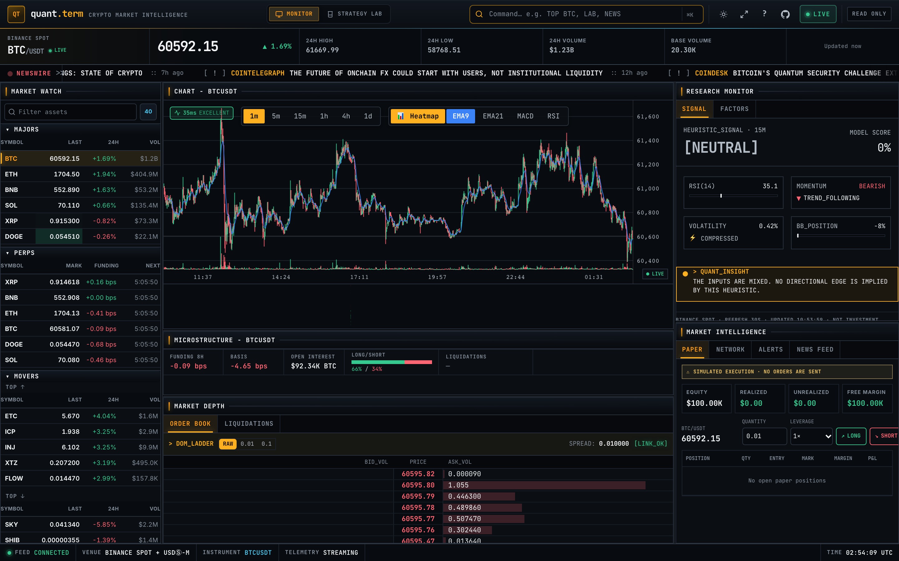
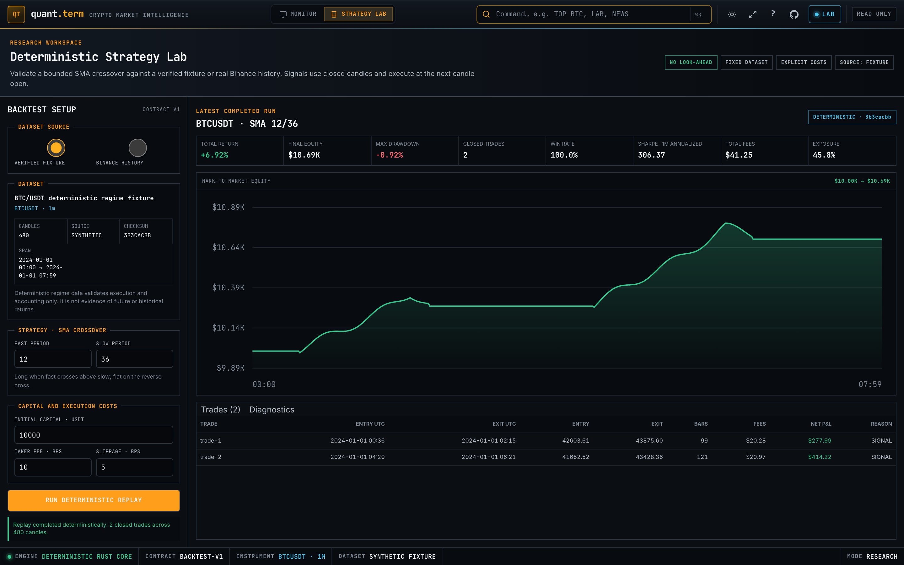
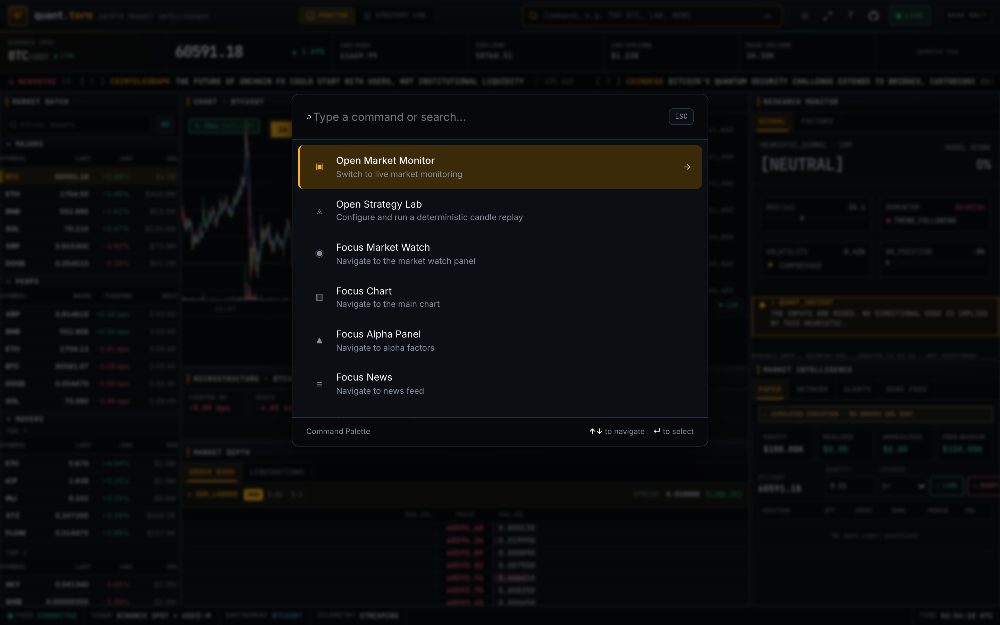

# quant.term

**A crypto research terminal for live market intelligence and deterministic strategy replay.**

**[Open the live terminal](https://quant-term.vercel.app)** · [Architecture](ARCHITECTURE.md) · [Indicators](docs/INDICATORS.md) · [Contributing](CONTRIBUTING.md)

<table>
  <tr>
    <td></td>
    <td></td>
  </tr>
  <tr>
    <td align="center"><b>Strategy Lab</b> — deterministic replay, explicit costs, inspectable trade ledger</td>
    <td align="center"><b>Command palette</b> — ⌘K across workspaces, symbols, and panels</td>
  </tr>
</table>

## Overview

`quant.term` combines a live, read-only crypto-market monitor with a deterministic Strategy Lab. The whole browser application is written in Rust and shipped to the browser as WebAssembly: the `quant-ui` Leptos crate renders the terminal, and the `quant-core` crate provides indicators, order-flow calculations, and the backtest engine used by both the UI and the TypeScript parity harness.

The Monitor workspace renders live Binance Spot candles, trades, and depth through a custom Canvas2D chart. The Strategy Lab replays a bounded SMA crossover with explicit fees, slippage, next-bar execution, equity, drawdown, and an inspectable trade ledger. Datasets come from either the bundled BTC/USDT validation fixture or Binance Spot klines fetched live from `data-api.binance.vision` for a user-selected symbol, interval, and lookback; every run records dataset provenance and reports candle gaps rather than filling them.

The `quant-core` engine and a kept TypeScript reference implementation share the versioned `backtest-v1` contract and golden correctness values, verified by the parity suite under `src/tests`. Synthetic results validate execution and accounting; they are not evidence of historical or future performance. No exchange credentials are accepted and no real orders are sent.

## Highlights

**Market monitor**

- Live Binance Spot watchlist, candles, aggregate trades, and top-20 depth
- Custom Canvas2D candlestick chart — volume, EMA overlays, native RSI/MACD panes
- Order-book depth heatmap strip synced to chart pan and zoom
- Binance USDⓈ-M funding, mark/index price, open interest, positioning, and liquidations
- OFI, volume delta/CVD, VPIN, Hurst, ADX, ATR, RSI, MACD, OBV, and VWAP research panels
- CoinDesk/Cointelegraph news, Bitcoin network and Fear & Greed snapshots, local price alerts

**Strategy Lab**

- Deterministic SMA replay — closed-candle signals, next-open fills, explicit fees and slippage
- Bundled synthetic fixture or live Binance klines, with FNV-1a checksums and gap reporting
- Equity curve, drawdown, exposure, Sharpe, fee totals, and a closed-trade ledger
- Shared Rust/WASM engine behind a versioned `backtest-v1` contract and TS parity suite

**Terminal**

- Resizable desktop workspace, command palette, keyboard shortcuts, and themes
- Margin-aware simulated long/short positions with realized and unrealized P&L
- Runs entirely in the browser as WebAssembly — no accounts, no keys, no real orders

## Quick start

### Requirements

- Node.js 24.x LTS (24.15 or newer)
- npm 12 or newer
- A current desktop browser
- For Rust changes only: a stable Rust toolchain with the `wasm32-unknown-unknown` target and the `wasm-bindgen` CLI

The generated wasm-bindgen bundles under `src/wasm` are committed, so `npm ci` and `npm run dev` work without a Rust toolchain.

~~~bash
git clone https://github.com/JWHaan/quant.term.git
cd quant.term
npm ci
npm run dev
~~~

Open [http://localhost:3000](http://localhost:3000). The dashboard does not require an `.env` file.

### Quality checks

~~~bash
npm run check
~~~

| Command | Purpose |
|---|---|
| `npm run dev` | Start the local Vite/Worker development server |
| `npm run lint` | Run ESLint with zero warnings allowed |
| `npm run type-check` | Type-check the browser shell, Worker, Vercel adapter, and build config |
| `npm test` | Run the Vitest suite once |
| `npm run test:watch` | Run Vitest in watch mode |
| `npm run test:coverage` | Run tests and enforce the configured full-tree baseline |
| `npm run wasm:build` | Rebuild the `quant-core` wasm bundle under `src/wasm` |
| `npm run wasm:check` | Run `cargo fmt --check` and `cargo clippy -D warnings` on `quant-core` |
| `./scripts/build-ui-wasm.sh` | Rebuild the `quant-ui` (Leptos) wasm bundle under `src/wasm` |
| `npm run build` | Build and verify the Sites artifact |
| `npm run preview` | Preview the production client |
| `npm run check` | Run lint, type-check, tests, and build |

## Repository layout

~~~text
ui/                          # quant-ui — Leptos 0.8 WASM frontend (the whole app)
├── src/app/                 # Root component, workspace mode, theme, shortcuts
├── src/features/            # Monitor panels, Strategy Lab, command palette
├── src/services/            # Feeds, REST, news, telemetry, provenance
├── src/stores/              # Signal-based global stores (Zustand equivalent)
└── src/ui/                  # Terminal chrome: panels, header/footer, command line
rust/                        # quant-core — Rust/WASM indicators, order flow, SMA replay
src/
├── rust-main.ts             # Browser entry point (loads the quant-ui bundle)
├── wasm/                    # Committed wasm-bindgen bundles for both crates
├── styles/                  # Global terminal stylesheet
├── backtest/                # Wasm adapter + TS reference replay for parity tests
├── utils/                   # Wasm indicator adapter + TS reference implementations
└── tests/                   # Parity, schema, adapter, and utility tests
worker/                      # Sites/Cloudflare Worker and shared news handler
api/                         # Vercel Function adapter for /api/news
schemas/                     # Versioned browser/native backtest contract
scripts/                     # Wasm build/check, dist clean/verify, driver, smoke
build/                       # Build-time Sites integration (Vite plugin)
~~~

The browser talks directly to public market endpoints. The edge layer only normalizes public RSS news behind `/api/news`. Strategy Lab runs locally in the same `quant-core` engine the UI links against — against the bundled synthetic validation fixture or Binance Spot public klines read directly by the browser; it does not send data or jobs to a remote service. See [ARCHITECTURE.md](ARCHITECTURE.md) for data flow and persistence details.

## Data and privacy

The terminal persists only browser-local preferences and simulations:

- selected symbol, watchlist, and theme
- workspace selection and alert definitions
- paper balance, open positions, realized P&L, and bounded trade history

Live market buffers, news, network snapshots, connection telemetry, and alert history stay in memory. Clearing site storage removes persisted preferences and paper state.

## Deployment

The same repository supports two edge targets:

- **OpenAI Sites / Cloudflare runtime:** `dist/client` plus `dist/server`
- **Vercel:** `dist/client` plus the `api/vercel-news.ts` Function adapter

See [docs/DEPLOYMENT.md](docs/DEPLOYMENT.md) for exact build, deploy, and smoke-test steps.

## Documentation

- [Architecture](ARCHITECTURE.md)
- [Deployment](docs/DEPLOYMENT.md)
- [Indicators and calculations](docs/INDICATORS.md)
- [Roadmap](ROADMAP.md)
- [Contributing](CONTRIBUTING.md)
- [Security policy](SECURITY.md)
- [Changelog](CHANGELOG.md)

## Scope

The current project does not provide live execution, exchange accounts, wallets, custody, authenticated on-chain analytics, options analytics, portfolio VaR/Greeks, production ML forecasts, remote backtest jobs, historical-performance claims, or guaranteed uptime and latency. Panels show unavailable states when upstream data fails; they do not manufacture replacement market values.

## License

[MIT](LICENSE) © the quant.term contributors.

---

Public market data · Simulated trading · Not financial advice

